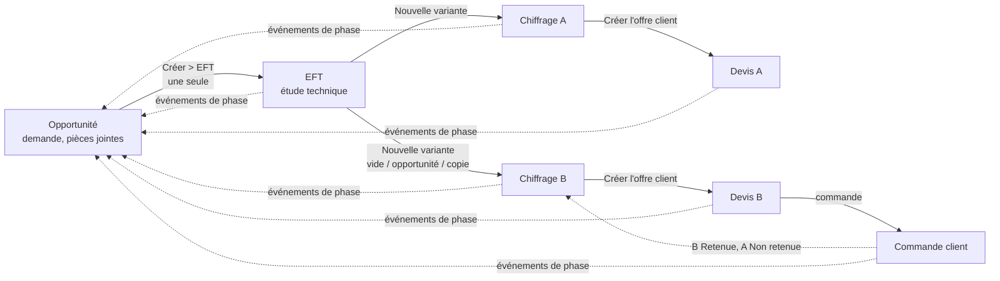

# Architecture de lsi_inspection

App Frappe / ERPNext v15 (compatible v16) pour l'inspection et le contrôle. **Natif d'abord, configuration plutôt que code** :
aucune valeur métier d'un client dans le code ; elles sont dans `config_initiale/profils/<profil>` (profil du site :
`lsi_profil` dans `site_config.json`).

## Flux métier



- **Opportunité → EFT** : une seule EFT active par opportunité (`chiffrage/etude.py`, `ouvrir_ou_creer`).
- **EFT → Chiffrages** : variantes A, B, C… (`chiffrage/variantes.py`) ; nom `<EFT>-<lettre>`, une nouvelle version (amend natif)
  garde sa lettre (`…-A-1`). Une seule variante « Retenue » par EFT (réversible).
- **Chiffrage → Devis** : un devis par variante validée (`chiffrage/devis.py`, chemin unique « Créer l'offre client »). Liens :
  `Quotation.lsi_chiffrage` et `Quotation.lsi_eft` ; onglet Connexions natif dans les deux sens (`override_doctype_dashboards`,
  `*_dashboard.py`).
- **Phases commerciales** : avancent seules. Chaque document (EFT, chiffrage, devis, commande, opportunité…) peut terminer une phase
  si un **Evenement Phase** le décrit et que le parcours du type d'opportunité l'utilise (`commercial/phases`).
- **Notifications** : 100 % natives (doctype Notification), dans le profil du site ; aucune tâche planifiée de l'app.

### Statut natif de l'opportunité avec plusieurs devis (comportement ERPNext, non modifié)

| Événement | Statut de l'opportunité |
|---|---|
| un devis est validé | « Quotation » (recalculé par ERPNext : `status_map` de l'opportunité) |
| un devis validé est annulé | « Open », ou « Quotation » si un autre devis est encore actif |
| une commande est validée depuis un devis | « Converted » (le devis passe « Ordered ») |
| « Déclarer perdu » sur l'opportunité | « Lost » **seulement si aucun devis n'est encore actif** |
| « Déclarer perdu » sur un devis | le devis passe « Lost » ; l'opportunité aussi si c'était son dernier devis actif |

Une commande ne peut pas contenir de ligne à quantité 0 : les lignes « tarif » d'un devis doivent recevoir une quantité (ou être
décochées dans « Créer l'offre client ») avant de commander.

## Modules

```
lsi_inspection/
├── constants.py              valeurs comparées dans le code (modes, sources, règles, états, statuts de phase…)
├── outils.py                 outils génériques (obligatoires serveur, défauts du référentiel, responsable d'un département)
├── config/                   configuration initiale : __init__ (chargement en insertion seule, export), alignement (patchs)
├── config_initiale/          commun/ (définitions de l'app) et profils/<profil>/ (valeurs d'un client) + manifeste.json
├── commercial/
│   ├── doctype/…             Evenement Phase, Parcours Phase, Phase Opportunite, Historique Phase, Departement Concerne, AO…
│   └── phases/               moteur des phases : parcours, responsables, tableau, evenements, ecran
├── chiffrage/
│   ├── doctype/…             EFT, EFT Ressource, Chiffrage (+ Chiffrage Position/Groupe/Etape/Repartition/Total Etape),
│   │                         Modele Chiffrage, Gamme, Gamme Ligne, Type Position
│   ├── moteur/               moteur de coût : formules (pures), couts, organisation, gammes, calcul, apercu, actions, modeles
│   ├── etude.py              EFT : une par opportunité, faisabilité, demande du client, déclaration de perte
│   ├── variantes.py          lettres, nouvelle variante (vide / opportunité / copie), comparaison, variante retenue
│   ├── devis.py              offre client, commande → retenue, devis envoyé, connexions natives
│   ├── report/besoins_chiffrage   besoins d'une variante (jours par désignation, catégorie, article)
│   └── print_format/         OT (impression de l'EFT), Fiche chiffrage, Devis groupe
├── referentiel/doctype/…     Famille de Type, Type Metier (listes de valeurs configurables)
├── public/js/
│   ├── commun/               utilitaires partagés EFT / Chiffrage (demande du client)
│   ├── chiffrage/            actions, apercu (temps réel), tableau (hiérarchique), chiffrage (écran)
│   ├── eft.js, opportunity.js, opportunity_list.js
├── patches/                  migrations (lot3b : renommage EFT → Chiffrage, reprise)
├── demo/lot3.py              jeu d'exemple réversible (run / annuler, registre privé du site)
└── tests/                    un fichier par module (voir CONVENTIONS.md)
```

### Points d'entrée

| Où | Quoi |
|---|---|
| `hooks.py` | blocs commentés : JS par doctype, `doc_events` (« * » → moteur des phases ; Opportunity ; Sales Order ; Communication ; Supplier Quotation), connexions, fixtures, `after_migrate` (configuration) |
| contrôleurs des doctypes de l'app | `EFT` → `etude`, `Chiffrage` → `variantes` + `moteur.calcul`, `Modele Chiffrage` → `moteur.modeles` |
| méthodes appelées par l'écran (`@frappe.whitelist`) | `etude.*`, `variantes.*`, `devis.creer_devis`, API du moteur (`chiffrage/moteur/__init__.py`), `commercial/phases` (`infos_phases`, `terminer_phase`) |

## Comment modifier

### Ajouter une façon de calculer un coût (nouveau type de position)
1. **Sans code** si une source existe : écran *Type Position* (mode + source + pool/règle). Recettes : guide testeur, section 1.5.
2. **Nouvelle source** : ajouter la valeur dans `constants.py` et dans la liste du champ `source_cout` (`type_position.json`), puis la
   brancher dans `chiffrage/moteur/couts.py::_cout_position` (une fonction `_cout_<source>(p, t)` qui renvoie `(cout, trace)` ;
   `None` = coût manquant, jamais d'exception). Test dans `tests/test_couts.py`.

### Ajouter un événement de fin de phase
1. **Sans code** si le document a un lien vers l'opportunité (ou vers un devis lié) : écran *Evenement Phase* (déclencheur
   Création / Validation / Annulation / État du workflow / Changement de statut), puis le choisir comme « Événement de fin » dans
   le parcours du type d'opportunité.
2. Événement **générique de l'app** : l'ajouter à `config_initiale/commun/evenement_phase.json` (inséré au prochain migrate).
3. Le document n'a pas de champ exploitable : ajouter un champ (fixture) renseigné par un hook, comme `Quotation.lsi_envoye`
   (`devis.devis_envoye`), puis un événement « Changement de statut » sur ce champ.

### Ajouter une notification
Toujours **native** : écran *Notification* (Nouveau / Validation / Changement de valeur / Jours avant-après…), destinataires par
champ (`commercial`, `lsi_commercial`, `opportunity_owner`, `lsi_responsable_service`, `utilisateur_pilote,lsi_departements`) ou
par rôle. Pour la livrer avec l'app : `bench --site <site> execute lsi_inspection.config.exporter_profil --args '["<profil>"]'`
(filtre du manifeste : notifications sans module des doctypes Opportunity, Issue, EFT, Chiffrage, Quotation).

### Modifier le moteur des phases (`commercial/phases`)
- `parcours.py` : lecture et contrôle du parcours ; `responsables.py` : qui est responsable ; `tableau.py` : état du tableau,
  historique en ajout seul, ToDo ; `evenements.py` : détection et application des événements ; `ecran.py` : hooks et bouton.
- Ne jamais écrire `sales_stage` ailleurs que dans `tableau._entete`. Tests : `test_phases`, `test_reouverture`, `test_ecran`.

### Modifier le moteur de chiffrage (`chiffrage/moteur`)
- Un calcul pur → `formules.py` (+ `tests/test_formules.py`, sans base). Un accès aux données → `couts.py`. L'ordre du calcul
  complet est dans `calcul.calculer` (structure → coûts → prix fixes → prix et marges → totaux).
- L'aperçu (`apercu.py`) appelle exactement le même moteur : ne pas dupliquer de calcul côté navigateur.

### Variantes, EFT, devis
- `variantes.py` : règle « une seule Retenue » dans `apres_changement` (appelé par `Chiffrage.on_change`, y compris après
  `db_set`). `etude.py` : unicité de l'EFT dans `valider`. `devis.py` : le seul endroit qui crée un devis.

### Écran (JS)
- Un fichier par doctype ; code partagé dans `public/js/commun/` ; l'ordre de chargement est celui de `doctype_js` (hooks.py).
- Aucun calcul métier en JS : le navigateur appelle `apercu` et affiche.
